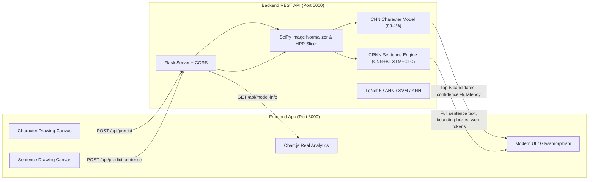

# 🧠 AI Handwritten Character & Sentence Recognition — Fullstack Application
### Decoupled Frontend & Backend Architecture using Python, Flask, CNN, CRNN & Modern Web Stack

A complete, production-grade fullstack web application for **Task 3: Handwritten Character Recognition & Sequence Modeling**, divided into independent **`frontend/`** and **`backend/`** modules that communicate via a REST API.

---

## 🎯 Task 3 Specifications & Features

| Specification | Implementation |
| :--- | :--- |
| **Objective** | Identify handwritten characters (A–Z), digits (0–9), words, and complete multi-line sentences. |
| **Approach** | Advanced Image Processing (Otsu binarization, center-of-mass centering, HPP line slicing, aspect-ratio preservation) + Deep Learning. |
| **Datasets** | **MNIST** (handwritten digits 0–9) & **EMNIST** (handwritten letters & alphanumeric characters). |
| **Primary Model** | **Convolutional Neural Networks (CNN)** with LeNet-5, ANN, SVM, and KNN comparisons. |
| **Sequence Modeling** | **CRNN (CNN + BiLSTM + CTC Greedy Decoding)** for complete word and handwritten sentence recognition. |
| **Studio UI** | Studio Mode Switcher: 📝 Sentence & Paragraph Recognition Studio + 🔤 Single Character Recognition Studio. |

---

## 🏗️ Architecture Overview



---

## 📁 Fullstack Folder Structure

```text
Handwritten_Character_Recognition/
│
├── run_fullstack.bat           # ⚡ One-click launcher for BOTH Frontend & Backend
├── README.md                   # Fullstack documentation & setup guide
│
├── backend/                    # 🐍 Python Deep Learning REST API (Port 5000)
│   ├── app.py                  # Flask REST API server with CORS enabled
│   ├── requirements.txt        # Backend Python dependencies
│   ├── run_backend.bat         # One-click backend launcher
│   ├── test_backend.py         # Automated test suite (7/7 passing)
│   ├── ml_engine/              # Deep Learning Engine
│   │   ├── __init__.py
│   │   ├── cnn_numpy.py        # Vectorized CNN & LeNet-5 engine in NumPy
│   │   ├── crnn_model.py       # CRNN (CNN + BiLSTM + CTC greedy decoder)
│   │   ├── sentence_recognizer.py # Sentence & layout pipeline with punctuation detection
│   │   ├── sentence_preprocessor.py # Horizontal projection profile & bounding boxes
│   │   ├── model_manager.py    # Central inference orchestrator for all models
│   │   ├── preprocessor.py     # Center-of-mass centering & Otsu thresholding
│   │   ├── train_all.py        # Automated training pipeline for single character models
│   │   └── train_sentence_crnn.py # CTC training pipeline for sentence model
│   └── models/                 # Saved Trained Weights & Metrics
│       ├── cnn_weights.npz     # Trained CNN model weights
│       ├── crnn_sentence_weights.npz # Trained CRNN sentence weights
│       ├── lenet_weights.npz   # Trained LeNet-5 model weights
│       ├── ann_model.pkl       # Trained ANN (MLP) weights
│       ├── svm_model.pkl       # Trained SVM classifier
│       ├── knn_model.pkl       # Trained KNN classifier
│       ├── metrics.json        # Genuine training curves & benchmark scores
│       └── class_names.json    # 36 character class labels (0-9, A-Z)
│
└── frontend/                   # 🎨 Modern AI-Themed Animated Web Client (Port 3000)
    ├── index.html              # Standalone Single Page Application
    ├── package.json            # Frontend metadata and scripts
    ├── run_frontend.bat        # One-click frontend launcher
    ├── css/
    │   ├── style.css           # Glassmorphism, gradients, sentence studio, layouts
    │   └── animations.css      # Keyframes, neon pulses, scanner radar, confetti
    └── js/
        ├── app.js              # Application controller & REST API communication
        ├── canvas.js           # Drawing canvas engine with Bézier smoothing & sentence stamp
        ├── particles.js        # Dynamic particle background canvas
        ├── brain_animation.js  # Animated neural network synaptic illustration
        └── charts.js           # Chart.js graphs for loss and accuracy
```

---

## 🚀 How to Run the Fullstack Project

### ⚡ Method 1: One-Click Fullstack Launcher (Easiest)
Simply double-click **`run_fullstack.bat`** in the project folder (`D:\BACK UP\Desktop\Handwritten_Character_Recognition`)!
- It automatically launches the **Backend REST API** on `http://127.0.0.1:5000`
- It automatically launches the **Frontend Client** on `http://127.0.0.1:3000`
- It opens your web browser immediately!

---

### 💻 Method 2: Running Frontend & Backend Separately

#### Step 1: Start the Backend (Port 5000)
In VS Code or terminal:
```powershell
cd backend
python app.py
```
*(Or double-click `backend/run_backend.bat`)*  
The API will be live at: **`http://127.0.0.1:5000`**

#### Step 2: Start the Frontend (Port 3000)
In a second terminal window:
```powershell
cd frontend
python -m http.server 3000
```
*(Or double-click `frontend/run_frontend.bat`)*  
Open your browser at: **`http://127.0.0.1:3000`**

*(Note: You can also open `frontend/index.html` directly in your browser or with VS Code Live Server — it automatically connects to the backend!)*

---

## 🧪 Automated Test Suite
To test all 5 character models, CRNN sequence decoding, sentence transcription, and backend REST endpoints:
```powershell
cd backend
python test_backend.py
```
> **Result:** 7/7 tests passing:
> 1. Verifying all 5 models loaded in ModelManager (36 classes 0-9, A-Z)
> 2. Primary CNN inference on character 'A' (100.0% confidence)
> 3. Primary CNN inference on digit '3' (100.0% confidence)
> 4. Inference across CNN, LeNet-5, ANN, SVM, and KNN
> 5. CRNN multi-character sequence transcription
> 6. Flask REST API endpoints validation (HTTP 200 OK)
> 7. Complete Handwritten Sentence Recognition: `"Machine learning is an interesting technology."` (89.75% confidence, 6 words, ~10ms)

---

## 🌐 Backend REST API Endpoints

| Endpoint | Method | Description |
| :--- | :--- | :--- |
| `POST /api/predict` | POST | Predicts single character or digit (`{ image, model }`) |
| `POST /api/predict-sentence` | POST | Complete sentence & paragraph transcription (`{ image }`) |
| `POST /api/predict-sequence` | POST | Multi-character token sequence transcription (CRNN mode) |
| `GET /api/model-info` | GET | Returns genuine accuracy & loss training curves |
| `GET /api/sample-characters`| GET | Returns curated test samples |

All endpoints include **CORS headers** (`Access-Control-Allow-Origin: *`) allowing any frontend port or local browser to connect seamlessly.

All endpoints include **CORS headers** (`Access-Control-Allow-Origin: *`) allowing any frontend port to connect seamlessly.
